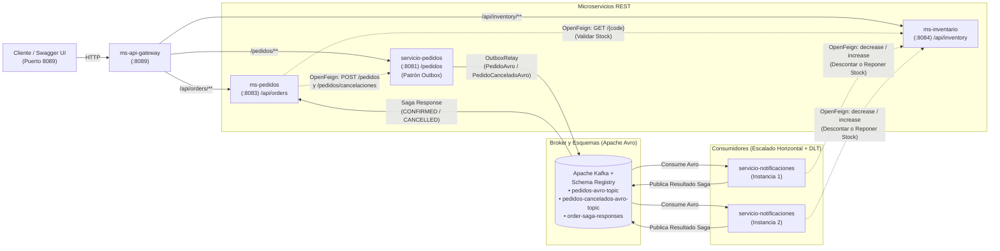

# Ecosistema de Microservicios Event-Driven (Spring Boot, Kafka & Avro)

Arquitectura de microservicios basada en **Arquitectura Hexagonal**, comunicación síncrona con **OpenFeign** y mensajería asíncrona tolerante a fallos con **Apache Kafka**, **Confluent Schema Registry (Apache Avro)**, **Patrón Outbox** y **Patrón Saga**.

---

## Arquitectura y Flujo de Eventos



---

## Patrones Implementados

* **Arquitectura Hexagonal (Ports & Adapters):** Separación estricta entre dominio, casos de uso e infraestructura en cada microservicio.
* **Patrón Outbox (`servicio-pedidos`):** Persistencia atómica en base de datos (`OutboxEvent`) y publicación asíncrona garantizada mediante `OutboxRelay` hacia Kafka.
* **Patrón Saga (Coreografía / Orquestación ligera):** Creación de órdenes en estado `PENDING` que se confirman (`CONFIRMED`) o compensan (`CANCELLED`) tras la respuesta del consumidor.
* **Contratos con Apache Avro:** Serialización binaria y validación de esquemas (`PedidoAvro` y `PedidoCanceladoAvro`) gestionada por **Confluent Schema Registry**.
* **Resiliencia e Idempotencia (`servicio-notificaciones`):** Reintentos exponenciales (`@RetryableTopic`), cola de mensajes fallidos (*Dead Letter Topic* - DLT), confirmación manual de *offsets* y control de duplicados.

---

## Arranque del Entorno

1. **Construir las imágenes y levantar todos los contenedores:**
   ```bash
   docker compose up -d --build
   ```

2. **Accesos principales:**
   * **API Gateway (Punto único de entrada):** `http://localhost:8089`
   * **Swagger UI Unificado (Pruebas REST):** `http://localhost:8089/swagger-ui.html`
   * **Kafka UI (Tópicos, Consumidores y Schema Registry):** `http://localhost:8080`

---

## Flujo de Prueba Rápido (Desde Swagger UI)

1. **Crear Stock Inicial (`ms-inventario`):** Ejecutar `POST /api/inventory` (ej. `PROD-100`, cantidad `10`).
2. **Crear Pedido (`ms-pedidos`):** Ejecutar `POST /api/orders` con `PROD-100` y cantidad `3`. El pedido nace como `PENDING`, viaja por Kafka en formato Avro, descuenta stock (queda en `7`) y pasa a `CONFIRMED`.
3. **Cancelar Pedido (`ms-pedidos`):** Ejecutar `PUT /api/orders/{orderId}/cancel`. El pedido pasa a `CANCELLED`, se publica `PedidoCanceladoAvro` en `pedidos-cancelados-avro-topic` y el stock se repone automáticamente a `10`.
