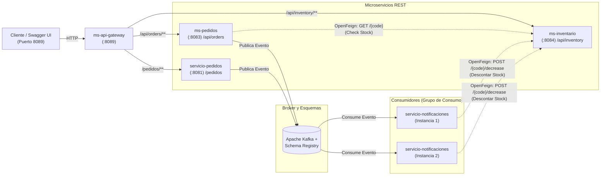

Levanta docker.
Genera las imagenes a partir del docker-compose y levanta las:docker compose up -d --build
la consola de kafka-ui estara en: http://localhost:8080/
Las peticiones a los micros iran por el: http://localhost:8089

## Arquitectura y Flujo de Eventos

