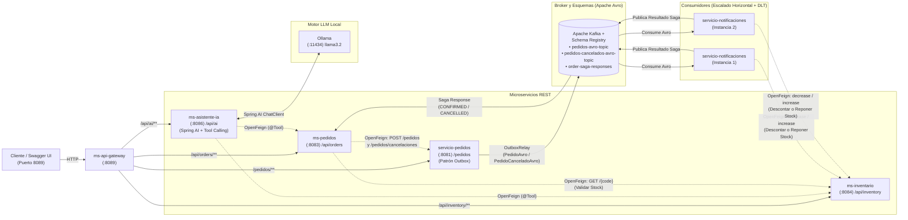

# Ecosistema de Microservicios Event-Driven & Spring AI (Spring Boot, Kafka, Avro & Ollama)

Arquitectura de microservicios basada en **Arquitectura Hexagonal**, comunicación síncrona con **OpenFeign**, mensajería asíncrona tolerante a fallos con **Apache Kafka**, **Confluent Schema Registry (Apache Avro)**, **Patrón Outbox**, **Patrón Saga** y un **Agente Conversacional con Spring AI y Ollama (*Tool Calling*)**.

---

## Arquitectura y Flujo de Eventos



---

## Patrones y Tecnologías Implementadas

* **Arquitectura Hexagonal (Ports & Adapters):** Separación estricta entre dominio, casos de uso e infraestructura en cada microservicio.
* **Agente Conversacional con Spring AI (`ms-asistente-ia` + `Ollama`):** Implementación del patrón **Tool Calling / Function Calling** usando el modelo local `llama3.2`. El asistente interpreta peticiones en lenguaje natural e invoca dinámicamente herramientas Java (`@Tool`) conectadas por OpenFeign a `ms-inventario` y `ms-pedidos`.
* **Patrón Outbox (`servicio-pedidos`):** Persistencia atómica en base de datos (`OutboxEvent`) y publicación asíncrona garantizada mediante `OutboxRelay` hacia Kafka.
* **Patrón Saga (Coreografía / Orquestación ligera):** Creación de órdenes en estado `PENDING` que se confirman (`CONFIRMED`) o compensan (`CANCELLED`) tras la respuesta del consumidor.
* **Contratos con Apache Avro:** Serialización binaria y validación de esquemas (`PedidoAvro` y `PedidoCanceladoAvro`) gestionada por **Confluent Schema Registry**.
* **Resiliencia e Idempotencia (`servicio-notificaciones`):** Reintentos exponenciales (`@RetryableTopic`), cola de mensajes fallidos (*Dead Letter Topic* - DLT), confirmación manual de *offsets* y control de duplicados.

---

## Arranque del Entorno

1. **Construir las imágenes y levantar todos los contenedores:**
   ```bash
   docker compose up -d --build
   ```
   *(Nota: En el primer arranque, el contenedor `ollama` descargará automáticamente el modelo `llama3.2` (~2 GB) y lo guardará en el volumen persistente `ollama_data`).*

2. **Accesos principales:**
   * **API Gateway (Punto único de entrada):** `http://localhost:8089`
   * **Swagger UI Unificado (Pruebas REST e IA):** `http://localhost:8089/swagger-ui.html`
   * **Kafka UI (Tópicos, Consumidores y Schema Registry):** `http://localhost:8080`
   * **Ollama API (LLM Local):** `http://localhost:11434`

---

## Flujo de Prueba Rápido (Desde Swagger UI)

### 1. Flujo REST y Eventos (Pedidos, Saga y Cancelaciones)
1. **Crear Stock Inicial (`2. Inventario`):** Ejecutar `POST /api/inventory` (ej. `PROD-100`, cantidad `50`).
2. **Crear Pedido (`1. Pedidos`):** Ejecutar `POST /api/orders` con `PROD-100` y cantidad `3`. El pedido nace como `PENDING`, viaja por Kafka en formato Avro, descuenta stock (queda en `47`) y pasa a `CONFIRMED`.
3. **Cancelar Pedido (`1. Pedidos`):** Ejecutar `PUT /api/orders/{orderId}/cancel`. El pedido pasa a `CANCELLED`, se publica `PedidoCanceladoAvro` en `pedidos-cancelados-avro-topic` y el stock se repone automáticamente a `50`.

### 2. Flujo Conversacional con IA (`4. Asistente IA`)
Selecciona **4. Asistente IA (Spring AI)** en el desplegable de Swagger UI y ejecuta `POST /api/ai/chat` con instrucciones en lenguaje natural:
* **Consultar stock:** `"¿Cuántas unidades quedan del producto PROD-100?"`
* **Crear pedido:** `"Compra 2 unidades de PROD-100 para juan@email.com por 40 euros"`
* **Consultar pedidos:** `"Muéstrame el listado de todos los pedidos"`
* **Anular pedido:** `"Cancela el pedido con ID <UUID>"`
